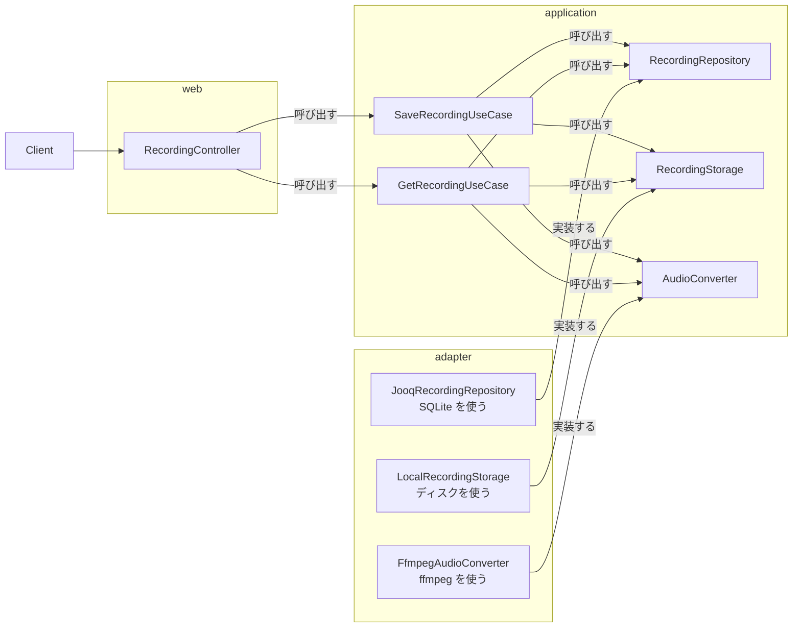
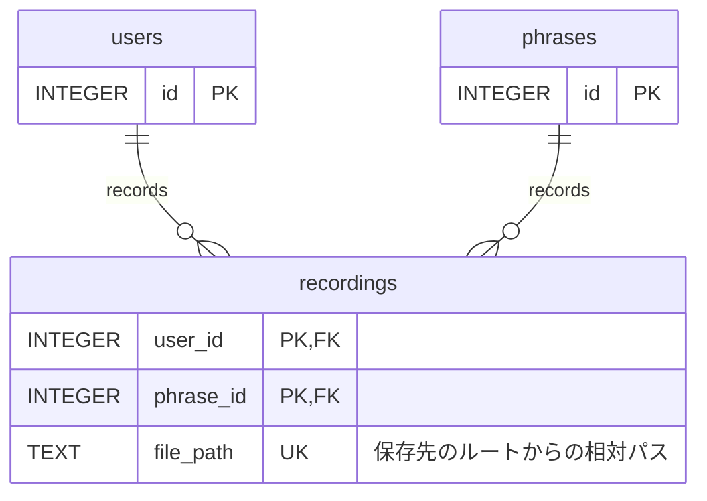
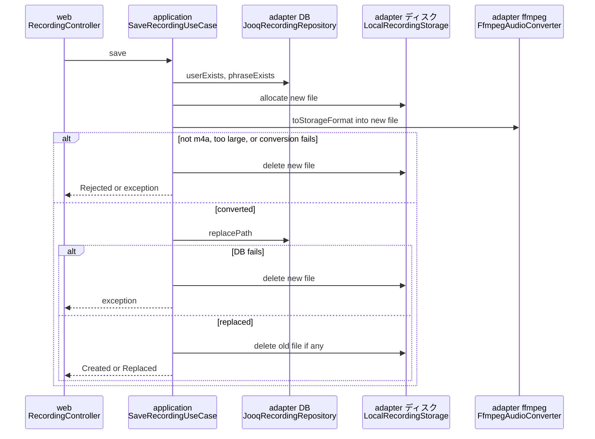
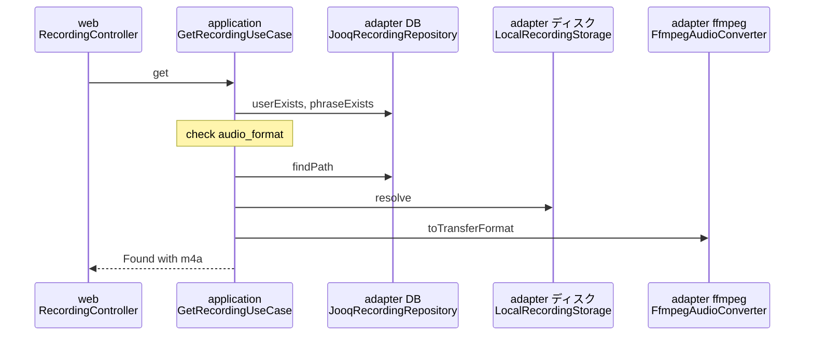

# Design Document

## Overview

練習フレーズの録音を m4a で受け取り、WAV に変換してディスクに保存し、取得のときに m4a に戻して返すサービスを作る。録音はユーザー ID とフレーズ ID の組で見分け、組ごとに最新の1件だけを持つ。課題の `curl` の手順を、`docker compose up --build` で起動したサービスにそのまま流せる状態にする。

### Goals

- 保存と取得の2つのエンドポイントで、要件 1〜3 の成功と失敗を応答し分ける。保存や変換が途中で失敗しても、DB の指す録音が常に完全なファイルとして残る（1.7）
- Dockerfile だけで、初期データの入ったサービスが手元で起動する（4.1、4.2）

### Non-Goals

- 録音の削除・一覧・履歴、m4a 以外のフォーマット、認証と認可、ファイルの暗号化、DB から指されなくなったファイルの掃除

## Boundary Commitments

### This Spec Owns

- 2つのエンドポイントの契約（パス、リクエスト、ステータスコード、エラーの本文）と、ID の形式の規則
- 3つのテーブル（`users`、`phrases`、`recordings`）のスキーマと初期データ、録音のファイルの置き場所と名前、m4a と WAV の相互の変換と受け付ける m4a の条件、Dockerfile、`compose.yaml`、モジュールの構成

### Out of Boundary

- ユーザーとフレーズの登録・変更・削除。サービスの外で決まり、このサービスは初期データとして受け取るだけ

### Allowed Dependencies

- 実行時: SQLite のファイル、ローカルのディスク（`/data`）、ffmpeg と ffprobe のコマンド。ネットワークの先のサービスには依存しない。モジュールの間は structure.md の依存の表のとおり。外部のライブラリは、`domain` はなし、`application` は `spring-context`、`adapter` は jOOQ と SLF4J、`web` は Spring MVC、`bootstrap` は Spring Boot（jOOQ と Flyway の starter を含む）と sqlite-jdbc に限る

### Revalidation Triggers

- エンドポイントのパス、ステータスコード、エラーの `code` を変える（クライアントが読み分けている）。送受信用のフォーマットを変える、または増やす。テーブルの列や制約、ID の形式の規則、録音のファイルの名前の付け方や DB に書くパスの形を変える

## Architecture

### Architecture Pattern & Boundary Map



- 枠はレイヤー（Gradle のモジュール）を表す。`application` の右の3つがポートで、処理を持たないインターフェース。ユースケースはポートのメソッドを呼び、実際の処理は `adapter` の実装クラスが行う（起動時に `bootstrap` が実装クラスを渡す）。図にない `domain` は ID やパスの値で、すべてのレイヤーから使う。`bootstrap` はすべてを組み立てる。依存の向き: `web → application → domain ← adapter`。ポートとアダプタ（ADR-0010）を、層ごとの Gradle のモジュールで強制する（ADR-0011）。アダプタは Spring に依存しない普通のクラスにし、`bootstrap` の設定クラスで設定値を渡して Bean にする。ユースケースは `@Service`、Controller は `@RestController` で登録する

## Data Models



- `users` と `phrases` は有効な ID のテーブル、`recordings` は組と保存したファイルのパスの対応のテーブル（5.4）。列はすべて NOT NULL で、`recordings` の主キーを `(user_id, phrase_id)` にして組ごとに1行だけ持つ（1.3）。初期データは `users` と `phrases` にそれぞれ ID 1〜3 を入れる。`db/seed` の繰り返し実行のマイグレーション（`R__`）で `INSERT OR IGNORE` する（ADR-0017）

## API Contract

| Method | Path | Request | Success | Errors |
|--------|------|---------|---------|--------|
| POST | `/audio/user/{user_id}/phrase/{phrase_id}` | `multipart/form-data` のフィールド `audio_file` に m4a | 201（新規）、204（置き換え）。本文なし | 400、404、413、415、500 |
| GET | `/audio/user/{user_id}/phrase/{phrase_id}/{audio_format}` | `audio_format` は `m4a` | 200、`Content-Type: audio/mp4`、本文は m4a | 400、404、500 |

- ID の形式は、先頭が 0 ではない数字だけの並び（正規表現で `[1-9][0-9]*`）で、`Long` に収まるもの（1〜9223372036854775807）。それ以外は、登録されていない ID と同じに扱う（3.2、3.3）。`audio_format` は小文字の `m4a` だけを受け付ける
- ファイルの上限は 10MB にする。数秒から十数秒の録音は 1MB 未満のため。上限を超えた本文を Tomcat が読み捨てずに接続を切ると 413 が届かないので、読み捨ての上限（`server.tomcat.max-swallow-size`）を 100MB に広げる。変換後の WAV にも 200MB の上限を設け、ビットレートをごく低くして長い音声を 10MB に詰めた m4a で、ディスクを埋められないようにする（普通の音質の 10MB の m4a は、WAV で約 100MB）
- エラーの本文は、エラーの JSON の形を決めた標準（RFC 9457 の Problem Details）に合わせ、Spring の `ProblemDetail` のクラスで作る。標準の項目に `code` を足し、同じステータスの中の原因を見分けられるようにする（例: `{"title":"Not Found","status":404,"detail":"ユーザー 9 は登録されていません","code":"USER_NOT_FOUND"}`）
- 確かめる順番は、POST が「ファイルの大きさ → ファイルの有無 → ユーザー ID → フレーズ ID → フォーマット（ffprobe でファイルの中身を見る）」、GET が「ユーザー ID → フレーズ ID → フォーマット（パスの `audio_format`）→ 録音の有無」。当てはまるもののうち最初のものを返す
- コンテナの中では Spring Boot の既定の 8080 番で待ち受け、`compose.yaml` でホストの 80 番に割り当てる（5.1）。ホスト側の番号は、割り当てを変えるだけで変えられる

## System Flows



- 図の矢印は、ユースケースがポートを通して呼ぶ実装を指す。ID が見つからないときは、最初の確認で `Rejected` を返して終わる（図では省略）。Controller は結果をステータスに、例外を 500 にする（Error Handling）
- DB を切り替えるまで DB は古いファイルを指したままなので、どこで失敗しても既存の録音は取得できる（1.7、ADR-0014）
- `replacePath` は、古いパスの読み出しと upsert を1つのトランザクションで行い、古いパスを返す。SQLite への接続は1本（HikariCP の上限を 1）にし、同じ組への保存が重なっても、古いファイルを取り違えない。ファイルの削除は、消せなくても警告のログを残して続ける。残るのは DB から指されないファイルだけで、取得には影響しない



- 取得は、どの段階でも当てはまらなければその場で `Rejected` を返し、変換に失敗すれば例外を上げる一本道で、後始末はない。取得の途中で同じ組の保存が古いファイルを消すと 500 になるが、受け入れる

## Error Handling

| Condition | Response | Requirements |
|-----------|----------|--------------|
| `audio_file` がない、空、multipart ではない | 400、`MISSING_AUDIO_FILE` | 1.4 |
| ファイルが 10MB を超える、または変換後の WAV が 200MB を超える | 413、`AUDIO_FILE_TOO_LARGE` | 1.6 |
| ffprobe で MP4 のコンテナと AAC の音声を確かめられない | 415、`UNSUPPORTED_AUDIO` | 1.5 |
| ユーザー ID が登録されていない、形式が正しくない | 404、`USER_NOT_FOUND` | 3.2 |
| フレーズ ID が登録されていない、形式が正しくない | 404、`PHRASE_NOT_FOUND` | 3.3 |
| `audio_format` が `m4a` ではない | 400、`UNSUPPORTED_FORMAT` | 2.3 |
| 組に録音がない | 404、`RECORDING_NOT_FOUND` | 2.2 |
| 変換、ディスク、DB の失敗、ffmpeg のタイムアウト | 500、`INTERNAL_ERROR`。原因はログにだけ書く | 1.7、2.4 |

- 業務の結果（400 の `UNSUPPORTED_FORMAT`、404、WAV の上限を超えたときの 413、415）は、ユースケースが sealed の結果型で返す。外の世界の失敗は例外で上がり、`ErrorHandler` が 500 にする。400 の `MISSING_AUDIO_FILE` と 413 は、Spring の例外（`MissingServletRequestPartException`、`MaxUploadSizeExceededException`）を `ErrorHandler` で受けて返す。multipart ではない要求は Spring の既定では 500 になるので、`MultipartException` も `MISSING_AUDIO_FILE` にする。空のファイル（0 バイト）は、`RecordingController` が `MultipartFile.isEmpty()` で確かめ、ユースケースを呼ばずに `MissingServletRequestPartException` を投げ、ほかの `MISSING_AUDIO_FILE` と同じく `ErrorHandler` に返させる。エラーの JSON は `ErrorHandler` だけが作る

## Requirements Traceability

| Requirement | Summary | Components | Tests |
|-------------|---------|------------|-------|
| 1.1 | m4a を WAV にして保存し組に記録 | SaveRecordingUseCase、3つのアダプタ | SaveRecordingUseCaseTest、FfmpegAudioConverterTest、AudioApiTest |
| 1.2 | 保存の成功を返す | RecordingController | AudioApiTest |
| 1.3 | 既存の録音を置き換える | SaveRecordingUseCase、JooqRecordingRepository | SaveRecordingUseCaseTest、JooqRecordingRepositoryTest、AudioApiTest |
| 1.4 | ファイルがないエラー | RecordingController、ErrorHandler | AudioApiTest |
| 1.5 | 読めないファイルのエラー | FfmpegAudioConverter、SaveRecordingUseCase、ErrorHandler | SaveRecordingUseCaseTest、FfmpegAudioConverterTest、AudioApiTest |
| 1.6 | 大きすぎるファイルのエラー | ErrorHandler、application.yml、FfmpegAudioConverter、SaveRecordingUseCase | SaveRecordingUseCaseTest、FfmpegAudioConverterTest、AudioApiTest |
| 1.7 | 失敗しても既存の録音を保つ | SaveRecordingUseCase、JooqRecordingRepository、ErrorHandler | SaveRecordingUseCaseTest |
| 2.1 | WAV を m4a にして返す | GetRecordingUseCase、FfmpegAudioConverter | GetRecordingUseCaseTest、FfmpegAudioConverterTest、AudioApiTest |
| 2.2 | 録音がないエラー | GetRecordingUseCase、ErrorHandler | GetRecordingUseCaseTest |
| 2.3 | 対応していないフォーマットのエラー | GetRecordingUseCase、AudioFormat、ErrorHandler | GetRecordingUseCaseTest、AudioApiTest |
| 2.4 | 読み出しや変換の失敗のエラー | GetRecordingUseCase、ErrorHandler | GetRecordingUseCaseTest |
| 3.1 | 録音を扱う前に ID を確かめる | RecordingKeyResolver | SaveRecordingUseCaseTest、GetRecordingUseCaseTest |
| 3.2 | ユーザーが見つからないエラー | RecordingKeyResolver、UserId、ErrorHandler | SaveRecordingUseCaseTest、GetRecordingUseCaseTest、AudioApiTest |
| 3.3 | フレーズが見つからないエラー | RecordingKeyResolver、PhraseId、ErrorHandler | SaveRecordingUseCaseTest、GetRecordingUseCaseTest |
| 4.1 | Dockerfile で起動できる | Dockerfile、compose.yaml、AudioStorageApplication | 手での確認 |
| 4.2 | 初期データが入った状態で受け付ける | `db/seed`、AudioStorageApplication | AudioApiTest、手での確認 |
| 5.1 | ポートなしの `http://localhost/` で受け付ける | compose.yaml | 手での確認 |
| 5.2 | `audio_file` のフィールドで受け取る | RecordingController | AudioApiTest |
| 5.3 | ディスクにファイルとして保存する | LocalRecordingStorage | LocalRecordingStorageTest |
| 5.4 | 3つのテーブルを持ちパスを記録する | `db/migration`、JooqRecordingRepository | JooqRecordingRepositoryTest |

## Testing Strategy

- **単体（application、フェイク）**: 業務の分岐を網羅する
  - 保存: 新規と置き換えで結果が分かれ、置き換えでは古いファイルが消える（1.1〜1.3）。m4a でなければ、または変換後の WAV が上限を超えれば、新しいファイルを消して拒む（1.5、1.6）。変換と DB の切り替えのそれぞれで失敗させ、DB のパスが変わらず、新しいファイルが残らない（1.7）。取得: 録音がない、フォーマットが違う、変換が失敗する（2.1〜2.4）。共通: 形式の正しくない ID（`abc`、`0`、`Long` を超える数）と登録されていない ID が、どちらも見つからない扱いになり、変換と保存のポートが呼ばれない（3.1〜3.3）
- **結合（adapter、本物）**: リポジトリは、一時的な SQLite に Flyway を流し、`replacePath` が古いパスを返して1行を保つ（1.3、5.4）。ストレージは、`allocate` が毎回違うパスを返し、`delete` がファイルがなくても失敗しない（5.3）。変換は、実機の m4a（iPhone のボイスメモで既定の圧縮のまま録ったものを人が用意する。「ロスレス」は ALAC になり拒まれる）がサンプリングレートとチャンネル数を保った WAV になり（1.1）、戻した m4a を ffprobe が AAC と読み（2.1）、テキスト、WAV、MP3、ALAC の m4a、途中で切れた m4a を拒み（1.5）、WAV の上限を小さく設定すると上限を超えた変換を `TooLarge` にする（1.6）
- **全体（bootstrap）**: `AudioApiTest` で Spring Boot を起動し、課題の `curl` と同じ要求を送る。保存して取得できる、置き換えで 204 になる、初期データの ID で受け付ける、空のファイルが 400 になる、404・413・415 の代表を1つずつ確かめる。**手での確認**: Dockerfile を作る PR と提出の前に、`docker compose up --build` で起動して課題の `curl` を流す（4.1、4.2、5.1）

## Related ADRs

- ADR-0010、ADR-0011 は Architecture、ADR-0012〜ADR-0014（m4a と WAV、ffmpeg と ffprobe、ファイルの名前と置き換えの順番）は System Flows と Components の前提
- ADR-0015〜ADR-0018（SQLite、jOOQ、Flyway と初期データ、1つのコンテナ）は Data Models と File Structure Plan、ADR-0019、ADR-0020 は Testing Strategy の前提

# Implementation References

## Components and Interfaces

| Component | Layer | Intent | Requirements | Dependencies |
|-----------|-------|--------|--------------|--------------|
| UserId、PhraseId | domain | ID の値と形式の規則。`UserId.parse(raw: String): UserId?` は形式が正しくなければ `null` を返す | 3.2、3.3 | なし |
| RecordingKey | domain | ユーザー ID とフレーズ ID の組 | 1.1、2.1 | なし |
| RecordingPath | domain | 保存先のルートからの相対パス | 5.3、5.4 | なし |
| AudioFormat | domain | 送受信用のフォーマット（`M4A` だけ）と、パスの文字列からの読み取り | 2.3 | なし |
| RecordingKeyResolver | application | 生の ID を確かめ、`RecordingKey` か `RecordingError` を返す | 3.1〜3.3 | RecordingRepository（P0） |
| SaveRecordingUseCase | application | 保存の手順。`save(userId: String, phraseId: String, audio: InputStream): SaveRecordingResult` | 1.1、1.3、1.5〜1.7 | RecordingKeyResolver、3つのポート（P0） |
| GetRecordingUseCase | application | 取得の手順。`get(userId: String, phraseId: String, format: String): GetRecordingResult` | 2.1〜2.4 | RecordingKeyResolver、3つのポート（P0） |
| RecordingController | web | HTTP の要求を受けてユースケースを呼び、結果をステータスと本文にする | 1.2、1.4、5.2 | 2つのユースケース（P0） |
| ErrorHandler | web | `RecordingError` と例外を、エラーの JSON（`ProblemDetail`）にする | 1.4〜1.7、2.2〜2.4、3.2、3.3 | Spring MVC（P0） |
| AudioStorageApplication | bootstrap | Spring Boot を起動する | 4.1、4.2 | すべてのモジュール（P0） |
| AdapterConfiguration | bootstrap | 設定値と jOOQ の `DSLContext` を渡して、3つのアダプタを Bean にする | 4.1 | adapter（P0） |
| AudioStorageProperties | bootstrap | 保存先のルート、ffmpeg と ffprobe のパス、タイムアウト、WAV の上限の設定値 | 4.1 | なし |

### 結果の型（application）

```kotlin
enum class RecordingError {
    USER_NOT_FOUND, PHRASE_NOT_FOUND, UNSUPPORTED_AUDIO, AUDIO_FILE_TOO_LARGE, UNSUPPORTED_FORMAT, RECORDING_NOT_FOUND,
}

sealed interface SaveRecordingResult {
    data object Created : SaveRecordingResult
    data object Replaced : SaveRecordingResult
    data class Rejected(val error: RecordingError) : SaveRecordingResult
}

sealed interface GetRecordingResult {
    class Found(val format: AudioFormat, val content: ByteArray) : GetRecordingResult
    data class Rejected(val error: RecordingError) : GetRecordingResult
}
```

### ポート（application）

```kotlin
interface RecordingRepository {
    fun userExists(id: UserId): Boolean
    fun phraseExists(id: PhraseId): Boolean
    fun findPath(key: RecordingKey): RecordingPath?

    // 1つのトランザクションでパスを切り替え、それまでのパスを返す（新規なら null）
    fun replacePath(key: RecordingKey, path: RecordingPath): RecordingPath?
}

interface RecordingStorage {
    // 組のディレクトリを作り、まだ使われていないパスを返す
    fun allocate(key: RecordingKey): RecordingPath

    fun resolve(path: RecordingPath): Path

    // ファイルがなくても、消せなくても例外を上げない（消せなければ警告のログを残す）
    fun delete(path: RecordingPath)
}

interface AudioConverter {
    // m4a（MP4 のコンテナと AAC）でなければ Rejected、変換後の WAV が上限を超えれば TooLarge。変換の失敗は AudioConversionException
    fun toStorageFormat(input: InputStream, output: Path): StorageConversion

    // 変換の失敗は AudioConversionException
    fun toTransferFormat(input: Path, format: AudioFormat): ByteArray
}

sealed interface StorageConversion {
    data object Converted : StorageConversion
    data object Rejected : StorageConversion
    data object TooLarge : StorageConversion
}
```

### アダプタ（adapter）

- **JooqRecordingRepository**（`adapter.db`、Outbound: SQLite、P0）
  - jOOQ の生成コードで3つのテーブルを読み書きする
  - `replacePath` は jOOQ のトランザクションの中で、古いパスを読んでから `INSERT ... ON CONFLICT DO UPDATE` する
- **LocalRecordingStorage**（`adapter.storage`、Outbound: ディスク、P0）
  - 設定のルートの下に `{user_id}/{phrase_id}/{UUID}.wav` を割り当てる
  - パスは型付きの ID と UUID だけから作り、要求の文字列をそのまま使わない
- **FfmpegAudioConverter**（`adapter.converter`、External: ffmpeg と ffprobe、P0）
  - 入力を一時ファイルに書き、ffprobe と ffmpeg を `ProcessBuilder` で起動する（ADR-0013）
  - ffprobe で、最初の音声のストリームが AAC であることを確かめ、それだけを変換する
  - 入力の形式を `-f mov` で固定し、プレイリストのような外部を読みにいく形式を受け付けない
  - WAV への変換では、ffmpeg の `-fs` で出力の大きさに上限（設定値、200MB）を付け、上限に達したら `TooLarge` を返す
  - 1回の起動に 30 秒のタイムアウトを設ける。一時ファイルは変換の中で消す

## File Structure Plan

パッケージは `io.github.hokkenikuatsu.audiostorage.{モジュール名}` とし、下の `…/` はそのパッケージのディレクトリを表す。

```
settings.gradle.kts                    # モジュールの一覧と build-logic の読み込み
build.gradle.kts
gradle/libs.versions.toml              # ライブラリとプラグインのバージョン
gradlew
build-logic/src/main/kotlin/
  kotlin-conventions.gradle.kts        # Kotlin、toolchain、ktlint、detekt、Kotest の共通設定
  ModuleDependencyRules.kt             # 依存してよいモジュールの表と、表にない依存でビルドを落とす検査
domain/
  build.gradle.kts
  src/main/kotlin/…/
    UserId.kt
    PhraseId.kt
    RecordingKey.kt
    RecordingPath.kt
    AudioFormat.kt
application/
  build.gradle.kts
  src/main/kotlin/…/
    SaveRecordingUseCase.kt            # SaveRecordingResult を含む
    GetRecordingUseCase.kt             # GetRecordingResult を含む
    RecordingKeyResolver.kt
    RecordingError.kt
    port/RecordingRepository.kt
    port/RecordingStorage.kt
    port/AudioConverter.kt             # StorageConversion と AudioConversionException を含む
  src/test/kotlin/…/
    SaveRecordingUseCaseTest.kt
    GetRecordingUseCaseTest.kt
    fake/FakeRecordingRepository.kt
    fake/FakeRecordingStorage.kt
    fake/FakeAudioConverter.kt
adapter/
  build.gradle.kts                     # Flyway の Gradle プラグインで build/ に SQLite を作り、jOOQ の SQLiteDatabase でコードを生成する
  src/main/kotlin/…/
    db/JooqRecordingRepository.kt
    storage/LocalRecordingStorage.kt
    converter/FfmpegAudioConverter.kt
  src/main/resources/db/
    migration/V1__create_tables.sql    # 3つのテーブル。jOOQ のコード生成にも使う
    seed/R__insert_valid_ids.sql       # 有効なユーザー ID とフレーズ ID
  src/test/kotlin/…/
    db/JooqRecordingRepositoryTest.kt
    storage/LocalRecordingStorageTest.kt
    converter/FfmpegAudioConverterTest.kt
web/
  build.gradle.kts
  src/main/kotlin/…/
    RecordingController.kt
    ErrorHandler.kt
bootstrap/
  build.gradle.kts
  src/main/kotlin/…/
    AudioStorageApplication.kt
    AdapterConfiguration.kt
    AudioStorageProperties.kt
  src/main/resources/application.yml   # DB、保存先、multipart の上限、ffmpeg の設定
  src/test/kotlin/
    …/AudioApiTest.kt
    io/kotest/provided/ProjectConfig.kt  # Spring の拡張を登録する（Kotest 6 はこの名前のクラスだけを読む）
testdata/audio/                        # テスト用の音声。受け付ける m4a と、受け付けないファイル
scripts/testdata/generate-audio.sh     # 受け付けないファイルを ffmpeg で作る
Dockerfile
compose.yaml
.dockerignore
README.md                              # 起動方法と curl の例、手を抜いた箇所と本番運用ならどうするか
docs/architecture.md                   # ER 図、シーケンス図、エラーの分岐。実装と同じ PR で更新する
```
