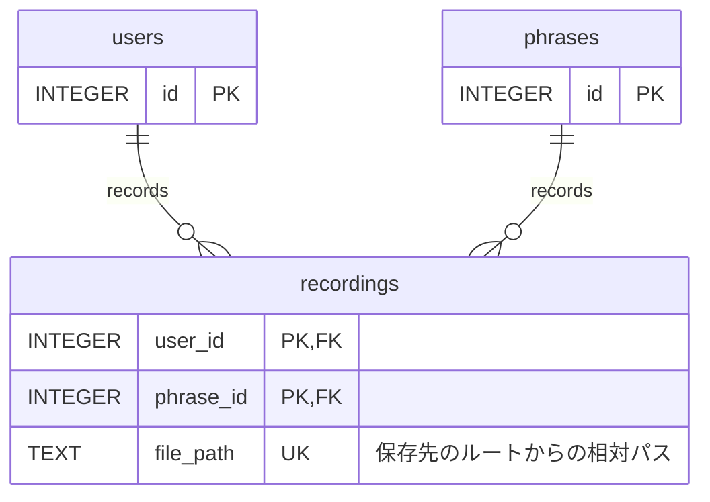
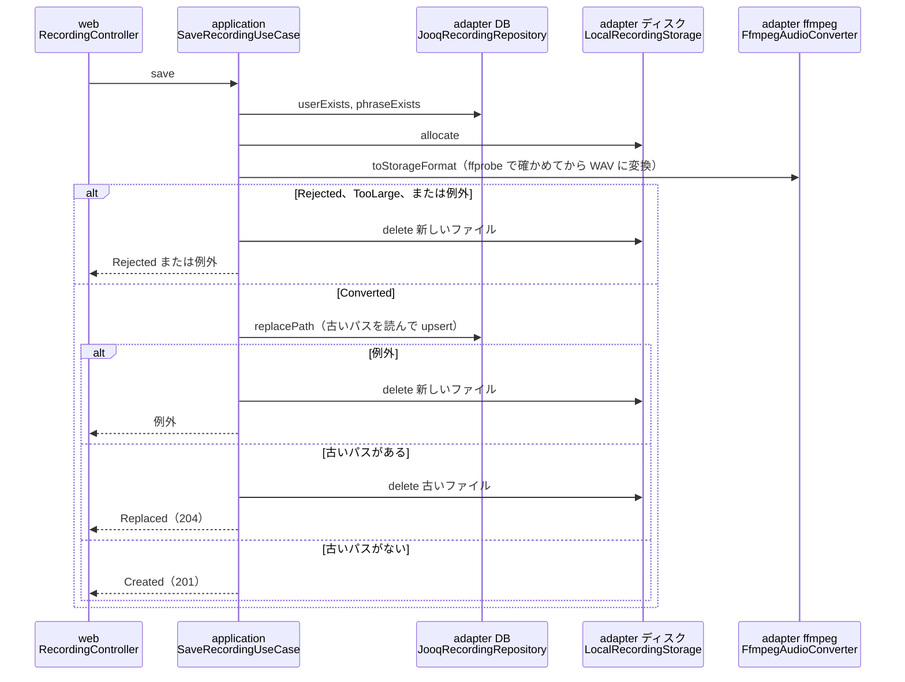
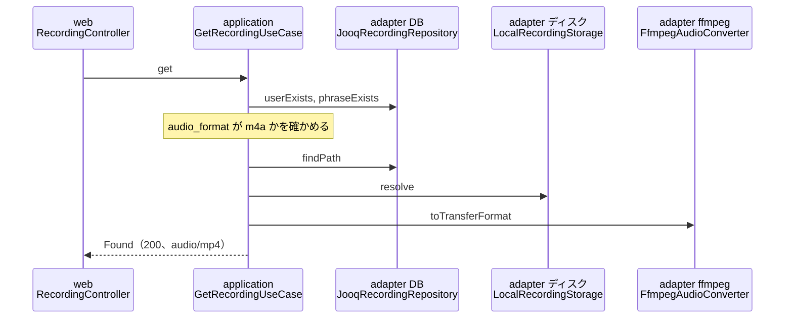
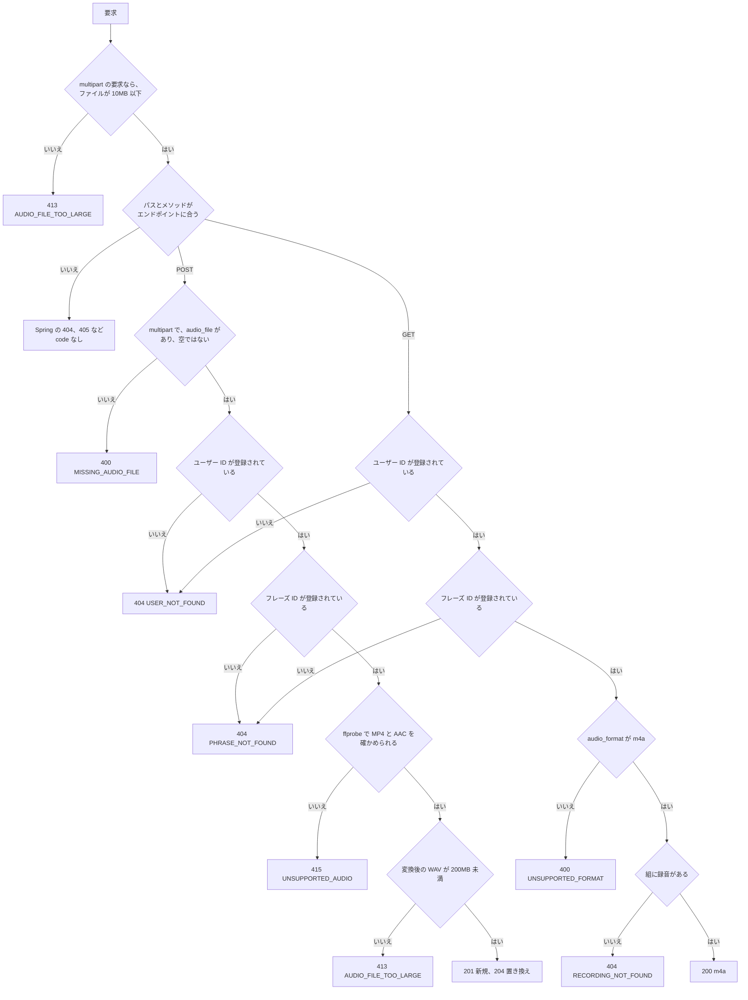

# アーキテクチャ

今動いているシステムの姿を書く。いつ更新するかは [開発の進め方の規約](conventions/workflow.md#ドキュメントの置き場) にある。

## データベース

SQLite に3つのテーブルを持つ。スキーマは [V1__create_tables.sql](../adapter/src/main/resources/db/migration/V1__create_tables.sql) にある。

- `users` と `phrases` は有効な ID のテーブル、`recordings` はユーザー ID とフレーズ ID の組と、保存した録音のファイルのパスの対応のテーブル
- 列はすべて NOT NULL。`recordings` の主キーを `(user_id, phrase_id)` にして、組ごとに1行だけ持つ
- 初期データとして、`users` と `phrases` にそれぞれ ID 1〜3 を入れる。初期データは [R__insert_valid_ids.sql](../adapter/src/main/resources/db/seed/R__insert_valid_ids.sql) にあり、すでにある ID は飛ばして入れる

## 録音の保存

`POST /audio/user/{user_id}/phrase/{phrase_id}` は、`audio_file` のフィールドの m4a を WAV に変換してディスクに書き、DB のパスを切り替える。

- 録音は、保存先のルート（`{data-dir}/recordings`）の下の `{user_id}/{phrase_id}/{UUID}.wav` に、保存のたびに新しい名前で書く。DB には、ルートからの相対パスを書く
- DB のパスを切り替えるまで、DB は古いファイルを指したままなので、途中で失敗しても既存の録音を取得できる
- `replacePath` は1つのトランザクションで行い、SQLite への接続は1本にする。古いファイルを消せなくても、警告のログを残して成功を返す
- ID が見つからないときは、`allocate` の前に `Rejected` を返して終わる（図では省略）

## 録音の取得

`GET /audio/user/{user_id}/phrase/{phrase_id}/{audio_format}` は、保存した WAV を m4a に変換して返す。

- どの段階でも当てはまらなければ、その場で `Rejected` を返す。変換の失敗は例外で上がる。後始末はない

## 検証とエラーの分岐

上から順に確かめ、最初に当てはまったものを返す。エラーの本文は `ErrorHandler` が、RFC 9457 の Problem Details に `code` を足した JSON で作る。

- Spring は、どのエンドポイントで受けるかを決める前に multipart の本文を読む。そのため、10MB を超えるファイルを送ると、パスやメソッドが誤っていても 413 になる
- ID は、先頭が 0 ではない数字だけの並びで `Long` に収まるものだけを読み、それ以外は登録されていない ID と同じに扱う
- 図のどこでも、変換、ディスク、DB の失敗や ffmpeg のタイムアウトのような想定外の例外が上がれば、500 の `INTERNAL_ERROR` を返し、原因はログにだけ書く
- 存在しないパス（404）や、エンドポイントが受け付けないメソッド（405）は、Spring が既定のエラーの本文で返す。本文に `code` は付かない
