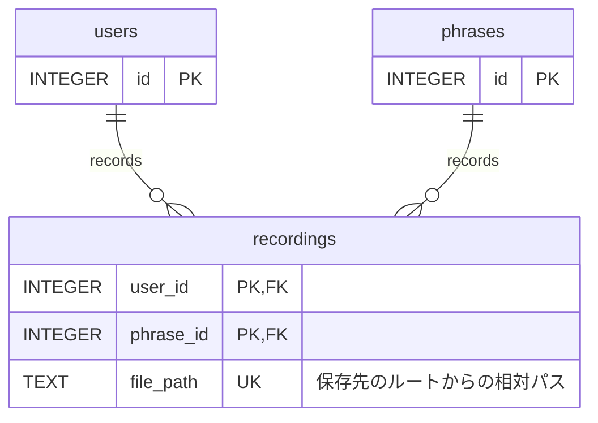

# アーキテクチャ

今動いているシステムの姿を書く。いつ更新するかは [開発の進め方の規約](conventions/workflow.md#ドキュメントの置き場) にある。

## データベース

SQLite に3つのテーブルを持つ。スキーマは [V1__create_tables.sql](../adapter/src/main/resources/db/migration/V1__create_tables.sql) にある。

- `users` と `phrases` は有効な ID のテーブル、`recordings` はユーザー ID とフレーズ ID の組と、保存した録音のファイルのパスの対応のテーブル
- 列はすべて NOT NULL。`recordings` の主キーを `(user_id, phrase_id)` にして、組ごとに1行だけ持つ
- 初期データとして、`users` と `phrases` にそれぞれ ID 1〜3 を入れる。初期データは [R__insert_valid_ids.sql](../adapter/src/main/resources/db/seed/R__insert_valid_ids.sql) にあり、すでにある ID は飛ばして入れる
- jOOQ のコードは、ビルドの中でスキーマのマイグレーションだけを流した SQLite から生成する。生成のための SQLite に初期データは入らない
